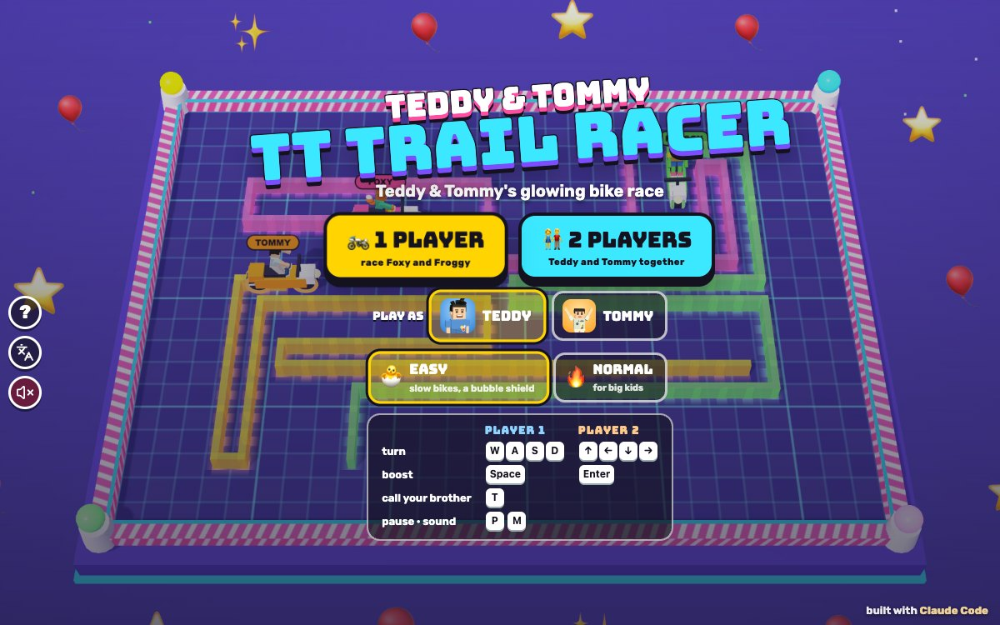

# TT Trail Racer

[](https://adong.github.io/trail-racer-tt/)

Press **?** any time (or tap the round **?** button on the left edge) to see the keys. The game waits while you look.
Tap the language button under it (the A文 icon) to switch between English and 中文; the dashboard and every game remember the choice.

**中文：** 光轮赛车：骑上发光的光轮车，在霓虹赛场里跑，车后面会留下一道光墙。用方向键转弯（不能直接掉头），别撞到光墙或围墙！最后还在骑的车手赢这一回合，最先赢 5 个回合的拿奖杯。单人和 Foxy、Froggy 比赛（随时叫兄弟来帮忙清光墙），或者 Teddy 和 Tommy 一起玩。

An arcade light-bike game starring Teddy and Tommy, built with Claude Code from plain JavaScript and Three.js on the shared Claude Games kit.
The riders zoom round a glowing toy arena, seen from above at a tilt, on chunky light bikes that leave a glowing trail wall behind them. Turn to cut the others off, and don't bump into any trail or the wall.
Nobody gets hurt: a bump is a soft BOING, the rider floats away in a bubble with sparkles, and his trail sparkles away a second later.
There are no image, model or audio files: the riders are the kit's blocky characters (Foxy and Froggy from TT Badminton), the bikes are built from boxes and rings, every texture is painted on a canvas, and every sound is synthesised.
It's our own game: our own name, characters, art and sounds.

The name lives in one place, `TR.TITLE` in `js/title.js` (and `TR.ZH`, 光轮赛车, for the 中文 logo). Change it there (and in the `<title>` of `index.html`) and the logo, menus and the ? panel follow.

## Play

- **Double-click `index.html`.** It works offline because Three.js and the kit are copied into `kit/`. Without internet the title font falls back to Arial Black.
- **Send one file:** `dist/trail-racer-tt.html` is the whole game in one file, about 820 KB. AirDrop or email it, then open it in a browser.
- Rebuild that file after any edit: `python3 kit/tools/bundle.py . --name trail-racer-tt`

Pick **🏍️ 1 PLAYER** or **👫 2 PLAYERS**, who to play as (1 player), and a difficulty, on the title screen.

| Difficulty | |
|---|---|
| 🐣 **EASY** (the default), for Tommy (5) | Slower bikes (4.5 cells a second) on a bigger arena (34 x 24). Each brother has a 🫧 bubble shield for his first bump of every round. 5 lives. Foxy and Froggy look less far ahead and sometimes daydream straight into the wall. |
| 🔥 **NORMAL**, for Teddy (8) | Faster bikes (7 cells a second) on a smaller arena (28 x 20). No bubble. 3 lives. Foxy and Froggy look further ahead, never turn into the wall while another way is open, and steer clear of a cell another bike is about to ride into. |

## Rules

- **The arena** is a grid. Every rider rides from cell to cell and leaves a glowing trail on every cell he has been on.
- **Turning:** the arrow keys turn your bike to that screen direction. A turn happens in the middle of the next cell. The key straight back does nothing: nobody ever turns back into his own trail. Two quick presses (say ↑ then ←) make a tight U-turn.
- **Bumps:** riding into the wall or any trail, your own too, is a bump: BOING! That rider is out for the round, floats away in a bubble, and his trail sparkles away a second later. Two bikes reaching the same cell at the same moment both bump.
- **🫧 Bubble shield (EASY):** a brother's first bump of a round pops his bubble instead ("BUBBLE SAVE!") and bounces him left or right, whichever way has more room. It comes back next round.
- **⚡ BOOST:** a short burst of speed (1.75 times as fast for 1.1 s), then it charges up again for 4 s. The bar on your card and the BOOST button show the charge.
- **Rounds:** 3, 2, 1, GO! The last rider riding wins the round: he stands up on his bike and does his move, and gets a star on his card. If the last riders bump together it's a tie round. You can pick your starting way during the countdown.
- **The cup:** the first rider to win 5 rounds wins the cup. The winner stands on a gold podium in the middle and does his signature move (Teddy shadow-boxes and sinks a 🏀 jump shot, Tommy does his Y pose ✌️, Foxy and Froggy wave), confetti, then **PLAY AGAIN** with your score and your HI-SCORE (kept for each difficulty).
- **Lives (1 player):** each bump costs a ❤️. With none left the cup ends: "GOOD TRY!"
- **Score:** 1 point a cell, 100 for every rider who bumps while you're still riding, 500 for winning a round.
- **When no brother is riding,** Foxy and Froggy finish the round 4 times as fast, so nobody waits long.
- **2 players:** Teddy and Tommy race each other and Foxy and Froggy, four bikes. There are no lives; the first to 5 rounds wins.
- **Phones:** on a small screen the arena is 70% of the size (EASY 24 x 17, NORMAL 20 x 14) so the cells stay big enough to see. Held upright, the arena is turned tall, so it fills the screen; the camera never turns or mirrors, so ↑ is always up the screen.

## Controls

| | Player 1 | Player 2 | Touch |
|---|---|---|---|
| turn | W A S D | ↑ ← ↓ → | tap the round pad that way |
| boost | Space | Enter | the ⚡ BOOST button |
| call your brother | T | | the big button with his face |

- In 1 player both key sets steer and both Space and Enter boost.
- Holding a key never repeats it, and leaving the window lets go of every key, so nothing can get stuck down.
- **P** or Esc pauses and **M** turns the sound on or off. The ❚❚ and 🔊 buttons at the top do the same. On the menus, the round speaker button under the A文 button (and the speaker in the ? panel) mutes too, and they all stay in step.
- **Menus:** ← → pick 1 or 2 players, ↑ ↓ (or W S) switch Easy / Normal, A D switch Teddy / Tommy, Enter or Space goes, 1 and 2 jump straight in. On the results, Enter plays again and Esc goes to the menu.
- **Touch:** a tap on the round pad turns that way, and sliding your finger round to another side turns again. The pad sits bottom left and BOOST bottom right (with two players, each brother has a pad in his corner and his BOOST button just above it). The ? and A文 buttons stay on the left edge, clear of the arena and the pads.

## Companion

Your companion is the other brother: **Tommy** comes for Teddy, and **Teddy** comes when Tommy is the one playing (`Kit.roster.buddyFor`).

- **Calling him:** press **T** or tap the big button with his face (or your own face at the top), any time and as often as you like. The race goes into slow motion (a cool blue glow round the screen) while he floats in beside you on a little glowing disc, at his smaller buddy size ("TOMMY IS HERE!").
- **His signature move:** Tommy does his Y pose with peace fingers; Teddy shadow-boxes and sinks a 🏀 jump shot.
- **A treat:** he tosses you a 🍦 💧 🧃 🍪 🍉 or 🍌, which floats over your head ("🍉 WATERMELON FROM TOMMY!").
- **The helper:** "TOMMY SAYS: ZAP! ALL CLEAR!" A glowing ring grows out from your bike and every trail within 6 cells (5 on NORMAL) is gone, anybody's, so you have room to ride. Then full speed again.
- **Call him again** while he's there and he ZAPs once more; call him after and he ZAPs straight away. So Tommy can protect you as long as you keep calling him.
- **Bye:** he waves and is gone in a puff. If you call him while you're out, he cheers instead: "TOMMY SAYS: YOU CAN DO IT!"
- **2 players:** both brothers are already riding, so **T** (or tapping a face at the top) is a fun ✋ HIGH FIVE!

## How it works, and how it's tested

- `js/sim.js` has the rules and no Three.js. Time moves in fixed ticks of 1/240 s whatever the frame rate, and Foxy and Froggy's dice are seeded, so the same keys at the same moments give the same race. It reports what happened as events, which `js/game.js` turns into effects, sounds and toasts.
- `js/bot.js` drives Foxy and Froggy (and the four riders in the demo behind the title screen). At each cell it looks at straight, left and right: never a way into the wall or a trail while another is open, and it likes lots of room (a flood fill), a long straight run, and keeping on straight.
- **The headless check** (`js/checks.js`), in Node with no npm, or `game.check()` in the browser console:

  ```bash
  node tools/check.js
  ```

  ```bash
  node tools/check.js -v
  ```

  - **Collisions on the grid:** riding into each of the four walls is a bump one cell short of the edge (EASY and NORMAL, wide and tall arenas); your own trail, someone else's trail, two bikes reaching the same cell (both out, a tie) and two bikes swapping cells.
  - **No turning straight back:** pressing the way you came from never turns you round, in every direction, and a quick two-step U-turn still works.
  - **CPU riders and the wall (NORMAL):** 12 seeded all-CPU cups (wide and tall arenas), 79,635 decisions: not once did a CPU rider pick a way into the wall while another way was open.
  - **Rounds and cups end:** 12 cups (EASY and NORMAL, 1 player, 2 players and all-CPU) all ended with someone on 5 wins, every round ended (the longest took 70 s), and wins plus ties add up to the rounds. A brother who never steers loses all his lives and the cup ends.
  - **Any frame rate:** the same scripted presses (turns, boosts and companion calls on every sixth of a second) give exactly the same race at 30, 48, 60, 90, 120, 144 and 240 frames a second, for 60 s of racing, in 1-player NORMAL, 1-player EASY and 2-player EASY.
  - **The rest:** the EASY bubble bounces once and comes back each round (none on NORMAL or for the CPU riders); BOOST is faster and has to charge; the companion's visit is slow motion, his ZAP clears every trail near you and none far away, it works again and again, and in 2 players T is a high five.
  - **The variant that must fail:** `game.prove()` (and the second part of `node tools/check.js`) runs the checks again with one rule broken at a time: no walls, no trail bumps, turning straight back allowed, CPU riders blind to the wall, rounds that never end, movement tied to the frame rate, no bubble, a ZAP that clears nothing, slow motion that never ends. All 9 were caught, and the real rules passed every check.
- **The play check with real keys** (`js/playcheck.js`), `game.playCheck()` in the page: everything goes in through `keydown`/`keyup` events on `window` and pointer events on the pad and the BOOST button, and time runs through `game.step`.
  - **Direction:** EASY and NORMAL, the wide arena and the tall one, 1 and 2 players, each player's own keys: → turns the bike right on the screen, ← left, ↑ up, ↓ down (measured where the bike is drawn, through the camera), and the key straight back does nothing: 64 turns.
  - **Touch:** a tap on the pad turns him the way the finger points, sliding round turns again, BOOST is faster, and in 2 players each pad steers its own brother: 24 taps plus slides and boosts.
  - **Stuck:** after a bubble bounce, the companion's slow-motion visit, pausing with a key held down, the window losing focus and a high five, he keeps riding and the next key turns him. The "keyboard kid" mashes keys (turns, boosts, now and then T) through whole cups on EASY and NORMAL, 1 and 2 players: a riding brother never stopped moving, and all 4 cups ended (31 rounds).
  - `game.playCheck.prove()` runs it with the arrows mirrored and with slow motion that never ends: the first fails the direction and touch checks (→ took the bike 45 px left), the second fails the stuck check. Both failed as they should, and the real game passed all three parts.
- **中文:** `tools/zh.json` visits the title, the ? panel, the countdown, play with BOOST, the companion and his ZAP, a bubble save, bumps and a round end, a cheer, pause, all three results (a cup win, a CPU cup, out of lives), a 2-player tie with a high five, and the touch title, in 中文: `Kit.lang.untranslated()` came back `[]` every time. A fresh English page has no Chinese except the kit's language button label.
- **Layouts:** `tools/layout.json` (touch on, mobile emulation) at 390x844, 740x360, 844x390, 768x1024, 1024x768, 820x1180 and 1180x820, 1 and 2 players: nothing covers the arena, no buttons overlap or leave the screen, the arena never runs under the HUD, and the title screen fits without scrolling. Cells are 12 to 25 px.
- **The single file** (`dist/trail-racer-tt.html`, opened from file://) boots with no outside scripts, its demo runs on real animation frames, the ? panel freezes it (0 ticks while open), and `game.check()` and `game.playCheck()` pass there too.
- **Screenshots** (headless Chrome over the DevTools protocol, no npm): `node tools/shoot.js tools/shots.json docs 1200 750` makes `docs/screenshot.jpg`; `node tools/shoot.js tools/keys.json` runs the rule check and the play check in a real page.
- All testing ran muted (`localStorage['claudeGames.muted'] = '1'`); sound was checked in code (`TR.Sfx.count`), not by ear.

```
index.html        the page: HUD, menus, touch controls, styles
js/title.js       the name
js/config.js      the numbers (speeds, arenas, boost, points, EASY / NORMAL)
js/friends.js     Foxy and Froggy (from TT Badminton)
js/sim.js         the rules
js/bot.js         Foxy and Froggy's riding
js/checks.js      the headless check
js/input.js       keys and the touch pad to turns and boosts
js/sfx.js         synth sounds
js/art.js         the arena, bikes, trails, bubbles, the ZAP ring
js/game.js        scene, camera, effects, HUD, flow, window.game
js/playcheck.js   the real-key play check
js/keys.js        the ? panel
js/zh.js          中文
tools/check.js    runs the headless check in Node
tools/shoot.js    screenshots and in-page checks with headless Chrome
kit/              the shared kit (synced, never edited here)
```

## Not verified

- Sound by ear: every test ran muted.
- Real touch devices and iOS Safari: touch was tested with synthetic pointer events and mobile emulation in headless Chrome.
- Real kids' difficulty: whether Tommy finds EASY easy and Teddy finds NORMAL fun. In the check's cups, an autopilot brother usually beats EASY Foxy and Froggy.
- Double-clicking `index.html` from Finder, the iPad home-screen icon, and the frame rate on an older iPad.
